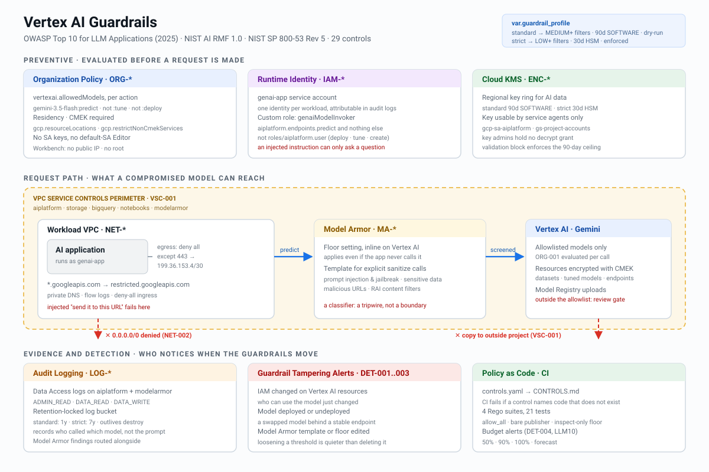

# gcp-vertex-ai-guardrails-terraform

Terraform that puts guardrails around generative AI on Google Cloud — which models can be called, by whom, what they can reach, what they are screened for, and who notices when someone loosens any of it — with a control matrix CI refuses to let you lie in.



## 🎯 Overview

Most "secure AI" guidance stops at the prompt: write a better system prompt, add a content filter, hope. That treats the model as the security boundary. It isn't one. A model will eventually follow an instruction it should not, because it reads text from places you do not control.

This repo puts the boundary back in the platform, where it can be enforced before a request is made and audited after:

- **Supply chain.** Only allowlisted Model Garden models, and only the actions approved for them — calling a model is not the same approval as fine-tuning it on your data.
- **Identity.** The application runs as one service account that can call models and nothing else. No keys exist to leak.
- **Reach.** Default-deny egress and a VPC Service Controls perimeter, so an injected "send this to that URL" fails at the network even when every application-layer control has been talked past.
- **Screening.** Model Armor on prompts and responses, with an inline floor setting that applies whether or not the application remembered to call it.
- **Evidence.** Data Access audit logs for every model call, locked retention, and alerts on the changes an attacker with a foothold would make first: IAM, model deployments, and the guardrails themselves.

Like its siblings ([aws](https://github.com/jmragsdale/aws-compliance-baseline-terraform) · [azure](https://github.com/jmragsdale/az-compliance-baseline-terraform) · [gcp](https://github.com/jmragsdale/gcp-compliance-baseline-terraform)), `controls/controls.yaml` is the source of truth: every control names the Terraform address that implements it, `controls/render.py` generates `CONTROLS.md`, and CI fails if a claimed address stops existing. **29 controls, all resolvable to real code.**

```
                      ORGANIZATION (or single project)
                                   │
     ┌──────────────┬──────────────┼──────────────┬───────────────┐
     │              │              │              │               │
  ORG POLICY     IDENTITY      MODEL ARMOR     CLOUD KMS       AUDIT + DETECT
  model allow-   genai-app SA  template:       regional key    DATA_READ/WRITE
  list (:predict predict-only  PI/jailbreak,   90d SOFT →      on aiplatform +
  not :tune)     custom role   SDP, URLs, RAI  30d HSM         modelarmor
  residency      no SA keys    floor setting:  agents only,    locked bucket
  CMEK required                inline on       admins can't    alerts: IAM,
  Workbench:                   every Vertex    decrypt         deploys, guard-
  no IP, no root               call                            rail changes,
     │                                                         budget
     └───────────────────────────┬──────────────────────────────┘
                                 │
                   WORKLOAD VPC        VPC-SC PERIMETER
                   deny-all egress     aiplatform, storage, bigquery,
                   one path out:  ───► notebooks, modelarmor
                   restricted.         dry-run (standard) → enforced (strict)
                   googleapis.com:443
```

## ✨ Features

- 🧬 **Model allowlist with action granularity** — `vertexai.allowedModels` lists `publishers/<p>/models/<m>:predict`. Tuning and deployment are separate approvals, so "we approved Gemini" does not quietly include "we approved training it on customer data."
- 🪪 **Predict-only runtime identity** — a custom role holding `aiplatform.endpoints.predict` instead of `roles/aiplatform.user`, which would also let the application create endpoints, deploy models and launch training jobs. An injected instruction that reaches a code path holding those rights has a much larger blast radius.
- 🛡️ **Model Armor in two layers** — a template for explicit sanitize calls (e.g. before retrieval), and a floor setting enforced inline on Vertex AI that binds at the organization and covers projects that do not exist yet. Guardrails that depend on every developer remembering to call them are guardrails with gaps.
- 🌐 **Egress is the exfiltration path, so it is closed** — default-deny in both directions, with exactly one way out: HTTPS to `restricted.googleapis.com`, which only serves VPC-SC-supported APIs.
- 🧱 **Perimeter that defaults to observing** — a VPC-SC perimeter enforced before anyone has read its violation log breaks CI and gets disabled within a week. `standard` runs dry-run; `strict` enforces.
- 🎚️ **`guardrail_profile` actually changes behaviour** — filter confidence (`MEDIUM_AND_ABOVE` → `LOW_AND_ABOVE`), key rotation (90d → 30d), key protection (SOFTWARE → HSM), log retention (1y → 7y), and perimeter mode. One `local.p` lookup map, no forked code paths.
- 🚨 **Alerts on guardrail tampering** — IAM changes on Vertex AI, model deploy/undeploy (how a swapped model reaches production without an application change), and Model Armor template or floor edits. Loosening a threshold is quieter than deleting a template and has much the same effect.
- 💸 **Unbounded consumption is a budget problem first** — budget alerts at 50/90/100% and on forecast, because a leaked credential or a looping agent shows up on the bill before anywhere else.
- 🧪 **4 Rego policy suites, 21 passing unit tests** — including an allowlist written with `allow_all`, a bare publisher entry, a Model Armor floor that exists but only inspects, and a firewall policy that can tell deny-all from allow-all on the same `0.0.0.0/0`.

## 🚀 Quick Start

```bash
git clone https://github.com/jmragsdale/gcp-vertex-ai-guardrails-terraform
cd gcp-vertex-ai-guardrails-terraform

# Verify the repo before trusting it
./scripts/validate.sh                # fmt, validate, tflint, checkov, trivy, conftest, matrix, gitleaks
python3 controls/render.py --check   # every claimed control resolves to real code

# Evaluate without an organization
cd examples/single-project
terraform init && terraform plan

# The real thing (read examples/org-wide/README.md first)
cd ../org-wide
terraform init && terraform plan
```

Nothing metered is created by default. Only `enable_org_policies` and `enable_identity` default to `true` — free, preventive, highest value. Everything else is opt-in.

Apply the organization posture in stages. [`examples/org-wide/README.md`](examples/org-wide/README.md) has the order, and the reason for it.

## 🔐 Controls

Full matrix: **[CONTROLS.md](CONTROLS.md)** — generated, never hand-edited.

| Framework | Version | Controls mapped | Distinct IDs |
|---|---|---:|---:|
| OWASP Top 10 for LLM Applications | 2025 | 21 / 29 | 8 of 10 |
| NIST AI Risk Management Framework | 1.0 | 29 / 29 | 7 |
| NIST SP 800-53 Rev 5 | Rev 5 | 29 / 29 | 30 |

By enforcement type: **14 preventive**, **11 detective**, **4 foundational**.

Control ID prefixes: `ORG-` org policy · `IAM-` identity · `ENC-` keys · `NET-` network · `VSC-` perimeter · `MA-` Model Armor · `LOG-` audit · `DET-` detection.

**Two OWASP categories are not covered, on purpose.** LLM08 (vector and embedding weaknesses) and LLM09 (misinformation) live in how an application builds its retrieval index and uses model output. No platform control reaches them, and mapping one anyway would be decoration.

**The AI RMF number is small on purpose too.** Seven subcategories, all in MEASURE and MANAGE, because those are the ones infrastructure can produce evidence for. GOVERN and MAP are organisational practice — policies, roles, impact assessments — and Terraform cannot implement a governance committee.

## ⚠️ What is and is not verified

**Verified:**

- `terraform fmt` clean, and every `.tf` file parses.
- Checkov: 36 passed, 0 failed, one inline skip with a written reason (CKV_GCP_43 — rotation comes from the profile map and cannot be statically resolved; a validation block enforces the same 90-day ceiling).
- 21 Rego unit tests pass under `conftest verify`.
- `controls/render.py --check` passes: all 29 controls resolve to declared Terraform addresses.
- **Model Armor resource schemas were checked against the provider's own documentation**, not written from memory. `google_model_armor_template` arrived in provider 6.43 and `google_model_armor_floorsetting` in 6.45; this repo pins `~> 7.0` for later permadiff fixes.
- The `vertexai.allowedModels` value format (`publishers/<p>/models/<m>:<action>`) matches Google's documentation.

**Not verified — say so out loud:**

- **Nothing here has been applied against a real project or organization.** It is plan-verified and static-analysis-verified. That is the honest ceiling for code that needs an org to exercise.
- **The allowlist governs Model Garden only.** Per Google's documentation, models registered in Vertex AI Model Registry are outside `vertexai.allowedModels`. A self-uploaded model needs its own review gate.
- **The Vertex AI service agent must exist before ENC-002 can bind to it.** It is created on first API use. On a brand-new project, run this once before applying the encryption module:
  ```bash
  gcloud beta services identity create --service=aiplatform.googleapis.com --project=PROJECT_ID
  ```
- **Model Armor is a classifier.** It reduces the volume of successful prompt injections and catches none of the ones it has not learned to see. It is a tripwire. Tool authority still has to be enforced in application code — see [agent-tool-gateway](https://github.com/jmragsdale/agent-tool-gateway).
- **Audit logs record who called which model, not what they said.** Prompt and response bodies are not in Data Access logs. Capturing them is an application decision with its own privacy cost, and this repo does not make it for you.
- **Budgets notify; they do not stop spend.** A hard ceiling needs Vertex AI quota limits.

## 💰 Cost

Everything metered is off by default. Verify against current pricing before budgeting.

| Feature | Gate | Cost driver |
|---|---|---|
| Org policy constraints | `enable_org_policies` | **free** |
| Service account + custom role | `enable_identity` | **free** |
| Cloud KMS | `enable_cmek` | per key version per month; **HSM is roughly 10× SOFTWARE**, which is why protection level is profile-driven |
| Workload VPC, DNS, flow logs | `enable_network` | DNS zone, flow log ingestion (sampled at 0.5) |
| VPC Service Controls | `enable_vpc_service_controls` | free — but violations block traffic, which is a different kind of cost |
| Model Armor | `enable_model_armor` | per request screened; the floor setting screens **every** Vertex AI call in scope |
| Data Access audit logs | `enable_audit_logging` | log ingestion; **the largest line item for a busy workload** |
| Alerts and budget | `enable_detection` / `enable_budget` | negligible |

The two decisions that dominate the bill are Model Armor floor scope and `DATA_READ` volume. They are also the two decisions a reviewer will ask you to justify.

## 💼 Talking Points

- **"The model is not the security boundary, so I didn't treat it like one."** Every control here assumes the model will eventually follow an injected instruction and asks what it can reach when it does.
- **"Calling a model and tuning a model are different approvals."** The allowlist is written per action. Most tutorials allow the publisher and move on.
- **"The runtime identity can ask a model a question and nothing else."** One permission, not a predefined role that also deploys and trains.
- **"The floor setting is the control that doesn't depend on developers."** The template only works when called. The floor applies to every Vertex AI call in scope, including projects created next quarter.
- **"The perimeter defaults to dry-run and that is a security decision."** An enforced perimeter nobody has modelled against real traffic gets disabled within a week.
- **"The alerts watch the guardrails, not the traffic."** The most useful thing an attacker with a foothold can do is quietly loosen a threshold.
- **"Where I wasn't sure of a resource schema, I checked the provider source instead of guessing."** And the README says which things are still unverified.

## 🏷️ Topics

`terraform` `google-cloud-platform` `gcp` `vertex-ai` `gemini` `model-armor` `generative-ai` `ai-security` `llm-security` `owasp-llm-top-10` `nist-ai-rmf` `nist-800-53` `vpc-service-controls` `organization-policy` `cmek` `policy-as-code` `opa` `rego` `conftest` `checkov` `guardrails`

---

Built by Jermaine Ragsdale — cloud security architect, CISSP, AWS Security Specialty, Google Cloud Generative AI Leader.
I do LLM application security reviews and cloud security assessments: **[jmragsdale.com](https://jmragsdale.com)**

MIT licensed.
